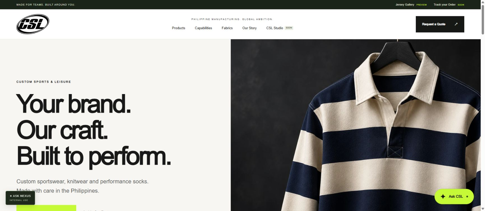
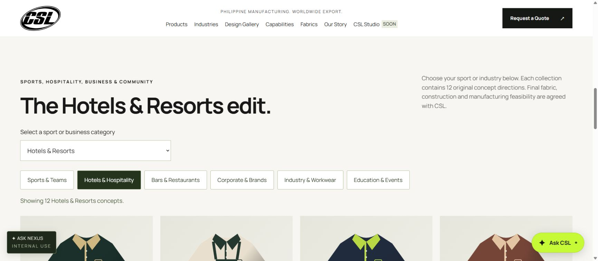

# German deployment — 24 October 2026 (SG/PH)
Public review URL: https://csl-mfg.com

## Installed
- Source: /opt/csl-mfg at application commit 1864bd8555261001e914cf472a38e35d4f4a6a24.
- App runtime: /opt/csl-mfg-runtime/node (existing Node 22.23.1 copied for this application; default system Node unchanged).
- Service: csl-mfg.service, systemd DynamicUser, loopback 127.0.0.1:3050, enabled on boot.
- Private records: /var/lib/csl-mfg (systemd StateDirectory; underlying private path is managed by systemd).
- Environment: /opt/csl-mfg/.env, root-only mode 0600, loaded by systemd.
- Apache domain configuration: /etc/apache2/sites-available/csl-mfg.com.conf.
- Certificate: /etc/letsencrypt/live/csl-mfg.com, both apex and www; expires 2027-01-21.
- ACME webroot: /opt/csl-mfg-acme; renewal config has a certificate-specific Apache reload deploy hook.
- HTTP and HTTPS www redirect to https://csl-mfg.com.
- DNS: apex A 161.97.137.234; www CNAME csl-mfg.com, DNS-only.

Only CSL-specific files/service/vhost were added. Apache configuration was validated before graceful reloads. Existing /opt/csl, csl.service and its Python listener on 3040 were left untouched. No OS upgrade, default Node replacement, NGINX, firewall, root-access policy or other site configuration changes.

## Verification
15 automated tests passed on the actual VPS. Public HTTPS homepage, RFQ save (synthetic deployment test), staff login, public guided assistant and mobile navigation were checked in Chrome. At 390px, no horizontal overflow was observed. Both csl and csl-mfg services and Apache remained active after deployment. Health endpoint returned status ok. HTTP and www redirects returned 301.



## Pending before business launch
- SEARCH_INDEXING=false is intentional during review. Enable only after content/contact details are approved.
- Mailtrap token, verified MAIL_FROM and ENQUIRY_EMAIL are unset. Forms persist privately but email notification delivery is NOT operational. Monitor/review stored enquiries before enabling public promotion.
- OpenAI key and model are unset. Both assistants provide guided fallback; no live AI calls.
- NEXUS shared preview code is configured as a salted server-only hash. No work sources are connected. Individual staff identity and permissions are required before private Trello/email retrieval.
- Trello order tracking, customer authentication, repeat requests and AI design Studio remain Phase 2 demos/provisions.
- Confirm retention, backup/restore and staff enquiry review ownership before accepting business traffic. No new backup schedule was installed.
- Existing server failures observed before this deployment: certbot.service, axon-staging-boot-guard.service, systemd-networkd-wait-online.service. They were not changed. CSL certificate issuance succeeded, but a renewal dry-run and shared renewal-job investigation remain outstanding.

## Maintenance
Update source as root after reviewing Git changes:
```sh
git -C /opt/csl-mfg pull --ff-only
cd /opt/csl-mfg
/opt/csl-mfg-runtime/node --test
systemctl restart csl-mfg
curl -fsS https://csl-mfg.com/health
```
Use DATA_DIR=/var/lib/csl-mfg when running the enquiry CLI; it otherwise defaults to repository-local var. Use root for private records. Never print .env or credentials to logs/chat. Restart csl-mfg after environment changes.

Rollback only this website by stopping csl-mfg and disabling only csl-mfg.com.conf, validating Apache configuration before a graceful reload. Keep private records and certificate for recovery; do not change any other vhost/service.


## Version 1.2 deployed — 24 October 2026
Application release 91f8aa942d3135acdcf15a858f0078cebcfa38ab was pulled to /opt/csl-mfg. All 19 tests passed on the German VPS; only csl-mfg was restarted. Original csl.service and Apache remained active. Live health and industry/export/gallery/original-photo pages, Phase 2 pages, sitemap, llms.txt and local Manrope font returned HTTP 200.

The live mobile gallery was checked at 390px: page width 375px, no horizontal overflow, 12 hotel concepts visible, mobile navigation opens/closes. Font resolves to Manrope. Staff mail routing is saved privately (Adam and Ben, CC Amit); sender is Amit with CSL company display name. No Mailtrap token was added and no live email was sent. Search indexing remains disabled during review.


